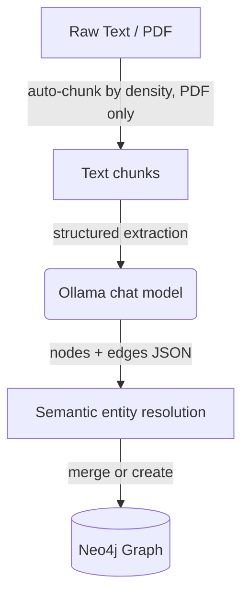
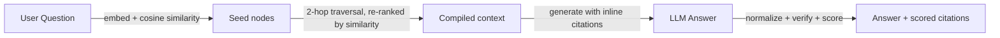

# 🔍 Sourcely — GraphRAG with Verifiable Citations

A Knowledge Graph-based Retrieval-Augmented Generation (GraphRAG) system. It extracts entities and relationships from your documents into a Neo4j graph, answers questions by traversing that graph across multiple hops, and attaches a scored, verifiable citation to every claim in its answer — flagging citations that don't actually trace back to a real source. All inference runs locally through Ollama; nothing is sent to an external API.

---

## Features

**Ingestion**
- Paste raw text, or upload a PDF — both are extracted into the knowledge graph through the same pipeline
- PDF chunking is automatic, with chunk size adapted to how dense the document's text is

**Knowledge graph construction**
- LLM-based extraction of entities and relationships into Neo4j
- Semantic entity resolution: the same entity mentioned differently across documents (e.g. "Dr. Vasquez" vs. "Vasquez") merges into one node instead of duplicating, using embedding similarity rather than brittle string matching

**Question answering**
- Natural-language questions against everything ingested so far
- Embedding-based semantic retrieval — finds relevant entities even when the question doesn't share literal wording with the source documents
- Multi-hop reasoning: traverses up to 2 hops out from the directly relevant entities

**Citation verification**
- Every claim in the generated answer carries an inline citation
- Each citation gets a confidence score blending keyword overlap and semantic similarity against its actual source
- Citations pointing to sources that don't exist are flagged as likely hallucinations
- Color-coded confidence badges in the UI (🟢 strong / 🟡 partial / 🔴 weak support)

**Transparency**
- A full audit trail (Trace Logs page) for every query: which nodes matched, their similarity scores, what was kept or filtered out
- Database Status tab with live node/edge counts and a full reset option

---

## Tech stack

Python · [LangChain](https://python.langchain.com/) (`langchain-ollama`, `langchain-community`, `langchain-text-splitters`) · [Ollama](https://ollama.com/) (`llama3.2` for chat, `nomic-embed-text` for embeddings) · [Neo4j](https://neo4j.com/) · [Streamlit](https://streamlit.io/) · [PyPDF](https://pypdf.readthedocs.io/) · Docker Compose

---

## Quick start (Docker Compose)

This runs all three services — the app, Neo4j, and Ollama — together, including the two required models.

```bash
cp .env.example .env

docker-compose up -d --build
```

Then open **http://localhost:8501**.


### Running without Docker

You'll need Neo4j and Ollama running locally yourself:

```bash
ollama pull llama3.2
ollama pull nomic-embed-text

pip install -r requirements.txt
streamlit run veriGraph.py
```

Set `NEO4J_URI`, `NEO4J_USER`, `NEO4J_PASSWORD`, `OLLAMA_HOST`, `OLLAMA_MODEL`, and `OLLAMA_EMBED_MODEL` as environment variables (or in a `.env` file) if your setup differs from the defaults in [config.py](config.py).

---

## How it works

### Ingestion



### Query



---

## Configuration

Defaults live in [config.py](config.py), overridable via environment variables (see [.env.example](.env.example)):

| Variable | Default | Purpose |
|---|---|---|
| `NEO4J_URI` | `bolt://127.0.0.1:7687` | Neo4j connection |
| `NEO4J_USER` / `NEO4J_PASSWORD` | `neo4j` / `password` | Neo4j credentials |
| `OLLAMA_HOST` | `http://localhost:11434` | Ollama server |
| `OLLAMA_MODEL` | `llama3.2` | Chat/extraction model |
| `OLLAMA_EMBED_MODEL` | `nomic-embed-text` | Embedding model |


