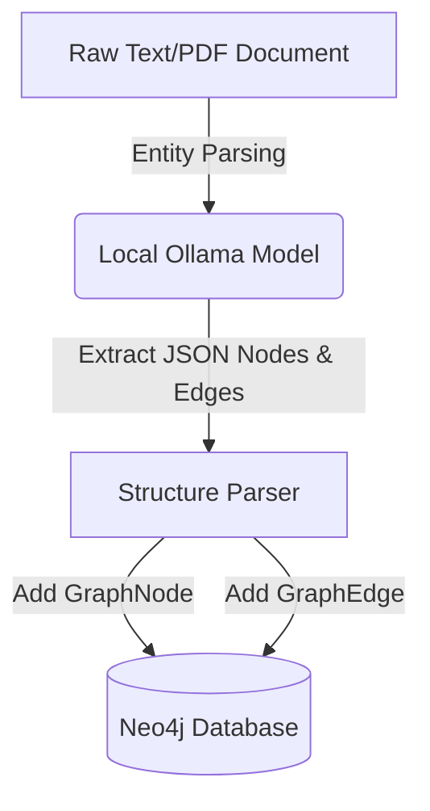
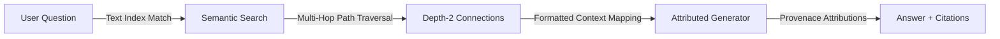

# 🔍 VeriGraph - Knowledge Graph Retrieval-Augmented Generation (RAG) with Verifiable Citations

An advanced Streamlit engine demonstrating how **Knowledge Graph-based Retrieval-Augmented Generation (RAG)** resolves multi-hop reasoning challenges with source provenance tracking.

---

## 🛠️ Technology Stack
* **UI Layer**: Streamlit (Python)
* **Graph Storage**: Neo4j Graph Database
* **Cognitive Inference**: Ollama (Running Mistral or Llama)
* **API Integration**: Python Neo4j Driver & Ollama Python SDK

---

## 🎯 Architectural Overview & Core Value
Standard semantic vector search matches text chunks based on keyword/semantic similarity, but fails at:
* Connecting disparate facts across multiple documents (multi-hop traversal).
* Outlining reasoning traces showing exactly how a decision was formulated.
* Attriburing verifiable source claims to the generated output.

** GraphRAG** addresses these challenges by:
1. **Parsing Entities & Relationships**: Building structured GraphNodes and GraphEdges from raw input files.
2. **Deep Path Traversal**: Traversing relational links inside Neo4j to find indirect associations.
3. **Provenance Validation**: Mapping inline answers directly to original snippets.

---

## 🚀 Quick Setup & Ingestion

### 1. Start Local Prerequisites
* **Ollama Inference Engine**:
  ```bash
  ollama pull llama3.2
  ```
* **Neo4j Graph Database Instance (Docker)**:
  ```bash
  docker run -d \
    --name neo4j \
    -p 7474:7474 -p 7687:7687 \
    -e NEO4J_AUTH=neo4j/password \
    neo4j:latest
  ```

### 2. Configure Environment & Script
* Navigate to the folder:
  ```bash
  cd VeriGraph
  ```
* Load the dependencies:
  ```bash
  pip install -r requirements.txt
  ```
* Launch the local Streamlit panel:
  ```bash
  streamlit run veriGraph.py
  ```

---

## 📖 Operational Pipeline

### Ingestion Pipeline


### Retrieval & Attribution Flow


---
## ⚙️ Configuration Properties
* **Neo4j Default Bolt URI**: `bolt://127.0.0.1:7687`
* **Neo4j Default User**: `neo4j`
* **LLM Local Model**: `llama3.2`
